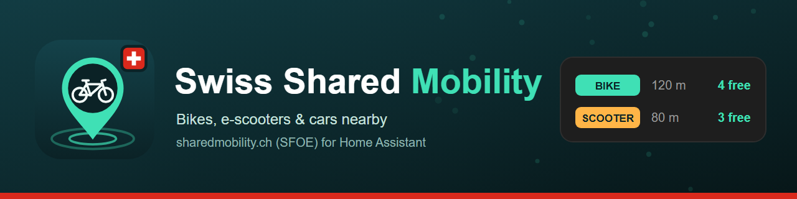

# Swiss Shared Mobility (sharedmobility.ch)

A Home Assistant custom integration that shows shared bikes, e-bikes, e-scooters, mopeds and cars available near you in Switzerland, sourced from the official **sharedmobility.ch** platform of the Swiss Federal Office of Energy (SFOE).

## Background

sharedmobility.ch combines the live data of the Swiss shared-mobility providers (around 45 systems, e.g. PubliBike, Velospot, Donkey Republic, nextbike, Bolt, Dott, Lime, Voi, Bird, Mobility car sharing) in one open API — no account or key required. The integration offers two independent ways to use it, chosen when you add the integration:

- **Area** — everything available within a radius around a location, counted per vehicle type, plus the distance to the nearest vehicle. Repeatable — add the integration again for another place (home, office, station).
- **Station** — one favorite station of a station-based system, e.g. your regular Mobility car-sharing location or bike-sharing dock. Repeatable as well.

## What it provides

### Area

| Entity | Description |
|---|---|
| `sensor.shared_mobility_<name>_available` | Number of available vehicles of the selected types within the radius. Attributes: `by_category`, `by_provider`, `radius_m`, `stations`. |
| `sensor.shared_mobility_<name>_<type>_available` | One per selected vehicle type (`bike`, `e_bike`, `cargo_bike`, `e_scooter`, `moped`, `car`, `other`). Attributes: distance and provider of the nearest one. |
| `sensor.shared_mobility_<name>_nearest` | Distance (m) to the nearest available vehicle of the selected types. Attributes: provider, type, pickup type, coordinates, station name for station-based systems. |
| `geo_location.*` | Optional (see options): the 50 nearest available vehicles as markers on any Map card (`geo_location_sources: swiss_shared_mobility`). |

`<name>` is the name you give the area, e.g. `sensor.shared_mobility_home_available`. Entity IDs are English whatever language Home Assistant uses.

A station-based offer (e.g. a car-sharing location with three cars) counts as all of its available vehicles. Vehicles a provider reports as disabled or reserved are not counted.

### Station

| Entity | Description |
|---|---|
| `sensor.shared_mobility_<station>_available` | Number of vehicles available at the station. Attributes: provider, vehicle types, address (if published), whether the station is renting/returning. Unavailable while the provider does not report the station. |

## Installation

### HACS (custom repository)

1. Open **HACS → ⋮ → Custom repositories**, add `https://github.com/prusuino/ha_swiss_shared_mobility` with category **Integration** — or use the button:

   

2. Download **Swiss Shared Mobility** and restart Home Assistant.

### Manual

1. Copy the `custom_components/swiss_shared_mobility` folder into your Home Assistant `config/custom_components/` directory.
2. Restart Home Assistant.

## Setup

1. Go to **Settings → Devices & Services → Add Integration** and search for **"Swiss Shared Mobility"**.
2. Choose:
   - **Area around a location**: give it a name, place the circle on the map (it starts at your home location; radius 100–2000 m), tick the vehicle types and set the update interval (default 2 min).
   - **Favorite station**: search the station by name (e.g. "Olten Bahnhof"), then pick it from the list. Only station-based systems have stations; free-floating vehicles are covered by an area.
3. Later changes (vehicle types, provider filter, interval, map markers) via **Configure** on the integration entry.

## Notes

- Only relevant for locations in Switzerland (and Liechtenstein, where a few providers report too).
- Data freshness depends on each provider's own feed. sharedmobility.ch refreshes about every minute; the default polling of 2 minutes keeps the load on the public API low.
- Some providers report their vehicles only with the generic type "Other" — tick **Other** if a provider you expect is missing.
- If the API is unreachable, the sensors become unavailable instead of showing stale data.

## Data source & license

This integration reads live data from the official sharedmobility.ch REST API (SFOE). Citing the source is required whenever this data is displayed — see [NOTICE.md](NOTICE.md). Every entity sets Home Assistant's `attribution` attribute accordingly.

## Disclaimer

This integration is provided **as-is, without any warranty**. Data is retrieved from a third-party published source and may be inaccurate, delayed, incomplete, or unavailable. A vehicle shown as available may already be taken when you get there — always check the provider's own app before relying on it. The author(s) accept **no responsibility or liability** for any damage, financial loss, incorrect readings, or other issues arising from using this integration, whether it stops working, behaves unexpectedly, or never worked correctly for your setup in the first place.

## License

Source code: MIT — see [LICENSE](LICENSE). Shared-mobility data: see [NOTICE.md](NOTICE.md) for the required attribution.

## Related integrations

More Home Assistant integrations from the same author:

- [Swiss Transport](https://github.com/prusuino/ha_swiss_transport) — live public-transport departure boards and saved connections
- [Swiss Charging Stations](https://github.com/prusuino/ha_swiss_charging_stations) — real-time availability of public EV charging stations in Switzerland
- [Swiss Parking](https://github.com/prusuino/ha_swiss_parking) — live free parking spaces in Swiss cities
- [Austrian Charging Stations](https://github.com/prusuino/ha_austrian_charging_stations) — real-time availability of public EV charging stations in Austria
- [Swiss Waters](https://github.com/prusuino/ha_swiss_waters) — live water temperature, water level, discharge and flood danger levels of Swiss rivers and lakes
- [Swiss Electricity Price](https://github.com/prusuino/ha_swiss_electricity_price) — electricity tariffs of any Swiss grid operator (ElCom)
- [Swiss Solar Reference Price](https://github.com/prusuino/ha_swiss_solar_reference_price) — the Swiss solar reference market price (SFOE)
- [Swiss Earthquakes](https://github.com/prusuino/ha_swiss_earthquakes) — recent Swiss earthquakes on the built-in map
- [Swiss Public Alerts](https://github.com/prusuino/ha_swiss_public_alerts) — official Swiss public alerts (Alertswiss) with home-location matching
- [Swiss Avalanche Bulletin](https://github.com/prusuino/ha_swiss_avalanche_bulletin) — the official SLF avalanche bulletin for your location
- [Swiss Hail Protection](https://github.com/prusuino/ha_swiss_hail_protection) — Swiss hail warnings for your blinds
- [Innoxel Master 3](https://github.com/prusuino/ha_innoxel_master3) — local control of the Innoxel Master 3 home-automation system

## Support

If this integration is useful to you, you can support its development:

