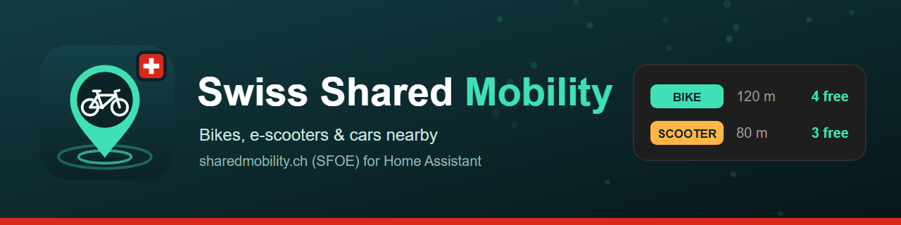

# Swiss Shared Mobility (sharedmobility.ch)



[](https://hacs.xyz/docs/marketplace/)
[](LICENSE)
<a href="https://www.buymeacoffee.com/prusuino"></a>

A Home Assistant custom integration that shows shared bikes, e-bikes, e-scooters, mopeds and cars available near you in Switzerland, sourced from the official **sharedmobility.ch** platform of the Swiss Federal Office of Energy (SFOE).

## Background

sharedmobility.ch combines the live data of the Swiss shared-mobility providers (around 45 systems, e.g. PubliBike, Velospot, Donkey Republic, nextbike, Bolt, Dott, Lime, Voi, Bird, Mobility car sharing) in one open API — no account or key required. The integration offers two independent ways to use it, chosen when you add the integration:

- **Area** — everything available within a radius around a location, counted per vehicle type, plus the distance to the nearest vehicle. Repeatable — add the integration again for another place (home, office, station).
- **Station** — one favorite station of a station-based system, e.g. your regular Mobility car-sharing location or bike-sharing dock. Repeatable as well.

## What it provides

### Area

| Entity | Description |
|---|---|
| `sensor.shared_mobility_<name>_available` | Number of available vehicles of the selected types within the radius. Attributes: `by_category`, `by_provider`, `radius_m`, `stations`. |
| `sensor.shared_mobility_<name>_<type>_available` | One per selected vehicle type (`bike`, `e_bike`, `cargo_bike`, `e_scooter`, `moped`, `car`, `other`). Attributes: distance and provider of the nearest one. |
| `sensor.shared_mobility_<name>_nearest` | Distance (m) to the nearest available vehicle of the selected types. Attributes: provider, type, pickup type, coordinates, station name for station-based systems. |
| `geo_location.*` | Optional (see options): the 50 nearest available vehicles as markers on any Map card (`geo_location_sources: swiss_shared_mobility`). |

`<name>` is the name you give the area, e.g. `sensor.shared_mobility_home_available`. Entity IDs are English whatever language Home Assistant uses.

A station-based offer (e.g. a car-sharing location with three cars) counts with all of its available vehicles, split by vehicle type. Vehicles a provider reports as disabled or reserved are not counted.

### Station

| Entity | Description |
|---|---|
| `sensor.shared_mobility_<station>_available` | Number of vehicles available at the station, named after the vehicle type (e.g. "Olten Bahnhof (Mobility) Cars"; "Vehicles" if the station holds several types). Attributes: provider, vehicle types, `by_category` (count per type), address (if published), whether the station is renting/returning. Unavailable while the provider does not report the station. |
| `sensor.shared_mobility_<station>_<type>_available` | Only for stations holding several vehicle types whose provider reports each vehicle: one count per type. Types are learned while the station has vehicles, so a sensor can appear later. Some providers (e.g. Velospot) only publish which types a station accepts — those stations get the single "Vehicles" sensor. |

## Installation

### Home Assistant Marketplace (custom repository)

1. Open **Settings → Marketplace → ⋮ → Custom repositories** (Home Assistant 2026.11 or newer; on older versions **HACS → ⋮ → Custom repositories**), add `https://github.com/prusuino/ha_swiss_shared_mobility` with category **Integration** — or use the button:

   [](https://my.home-assistant.io/redirect/hacs_repository/?owner=prusuino&repository=ha_swiss_shared_mobility&category=integration)

2. Download **Swiss Shared Mobility** and restart Home Assistant.

### Manual

1. Copy the `custom_components/swiss_shared_mobility` folder into your Home Assistant `config/custom_components/` directory.
2. Restart Home Assistant.

## Setup

1. Go to **Settings → Devices & Services → Add Integration** and search for **"Swiss Shared Mobility"**.
2. Choose:
   - **Area around a location**: give it a name, place the circle on the map (it starts at your home location; radius 100–2000 m), tick the vehicle types and set the update interval (default 2 min).
   - **Favorite station**: search the station by name (e.g. "Olten Bahnhof"), then pick it from the list. Only station-based systems have stations; free-floating vehicles are covered by an area.
3. Later changes (vehicle types, provider filter, interval, map markers) via **Configure** on the integration entry.

## Dashboard

The integration ships a **dashboard strategy**: a recipe Home Assistant renders in the browser, rather than a dashboard written into your configuration. Nothing is stored, nothing is overwritten, and the result follows your setup — add a config entry and its section appears on the next page load; remove one and it is gone.

The integration deliberately does not create or modify any dashboard on your behalf — your dashboards stay entirely under your own control.

### Adding the strategy as a resource

The integration serves the strategy file, but registering it as a Lovelace resource is left to you — the resource list is part of your dashboard configuration, and an integration has no business writing into it. It is a one-time step:

**Settings → Dashboards → ⋮ (top right) → Resources → + Add resource**

| Field | Value |
|---|---|
| URL | `/swiss_shared_mobility_files/swiss-shared-mobility-dashboard.js` |
| Resource type | JavaScript module |

The *Resources* entry is only shown when **Advanced mode** is enabled in your user profile (click your name at the bottom of the sidebar). Then reload the page (Ctrl/Cmd+Shift+R).

### Using the strategy

1. **Settings → Dashboards → + Add dashboard → New dashboard from scratch**, give it a name.
2. Open it, then **✏️ (edit) → ⋮ → Raw configuration editor**.
3. Replace the entire content with:

```yaml
strategy:
  type: custom:swiss-shared-mobility
views: []
```

4. Save.

You get:

- a **Map** view — the vehicles currently reported around your areas on a full-screen map, zoomed to fit them. It is only there while an area has *show on map* enabled and vehicles are reported; the markers are transient, so the view appears and disappears with them;
- an **Areas** view — one section per area: the total, the distance to the nearest vehicle and one tile per vehicle type;
- a **Stations** view — one section per favourite station with its vehicle count, and one tile per type for stations that report several. The source is credited at the bottom.

The strategy also appears under **+ Add dashboard** as *Swiss Shared Mobility*, which does the same thing without the raw editor.

Everything the strategy produces is a normal Home Assistant dashboard built from standard cards. If you would rather arrange things yourself, the entities above are all you need — the strategy is an offer, not a requirement.

### Adjusting the strategy

A strategy dashboard has no card editor — the layout is generated fresh on every load. You still have two ways to shape it without giving that up:

**Options.** Anything you add under `strategy:` is passed to the recipe:

```yaml
strategy:
  type: custom:swiss-shared-mobility
  title: My title
  max_columns: 3
views: []
```

| Option | Effect |
|---|---|
| `title` | dashboard title |
| `max_columns` | column count of the generated section views |
| `map: false` | leave out the map view |

**One view inside your own dashboard.** Instead of a separate dashboard, let the strategy fill a single view of one you already have. Open your dashboard's raw configuration editor and add a view:

```yaml
views:
  - title: Home
    # ... your own cards ...
  - title: Swiss Shared Mobility
    strategy:
      type: custom:swiss-shared-mobility
```

That view is regenerated like the full dashboard is, so new config entries still appear by themselves, while every other view stays yours to edit. The same options work here too.

> **Take control** (⋮ menu) turns a strategy dashboard into a static one you can edit card by card — but it is one-way: the dashboard stops following your config entries from then on. Prefer the two approaches above.

## Automations

On Home Assistant 2026.10 or newer the integration adds its own entries to the automation editor's trigger list, on 2026.11 or newer also to the condition list. They target the integration's own sensors (pick an entity, an entry's device or an area); the usual *for* duration and behaviour options apply.

| Trigger | Fires when |
|---|---|
| **Vehicle count crossed a threshold** | the number of available vehicles of an area or a station (all vehicles or one category) crosses the threshold you set |
| **Nearest vehicle crossed a distance** | the distance to the nearest vehicle of an area crosses the distance you set (metres) |

| Condition | Passes while |
|---|---|
| **Vehicles are available** | at least the **minimum number** of vehicles is available |
| **Nearest vehicle is within** | the nearest vehicle is within the **distance** in metres |

```yaml
triggers:
  - trigger: swiss_shared_mobility.vehicle_count_crossed_threshold
    target:
      entity_id: sensor.shared_mobility_zurich_hb_e_bike_available
    options:
      threshold:
        type: above
        value:
          number: 0
conditions:
  - condition: swiss_shared_mobility.nearest_vehicle_within
    target:
      entity_id: sensor.shared_mobility_zurich_hb_nearest
    options:
      metres: 300
```

## Notes

- Only relevant for locations in Switzerland (and Liechtenstein, where a few providers report too).
- Data freshness depends on each provider's own feed. sharedmobility.ch refreshes about every minute; the default polling of 2 minutes keeps the load on the public API low.
- Some providers report their vehicles only with the generic type "Other" — tick **Other** if a provider you expect is missing.
- If the API is unreachable, the sensors become unavailable instead of showing stale data.
- **Download diagnostics** (entry menu under **Settings → Devices & services**) gives the entry's configuration, what the integration last fetched and the current state of its entities, with coordinates, credentials and the entry's title and unique id redacted. Entity ids and names stay readable and can contain a place or stop name, so look through the file before attaching it to a public issue.

## Data source & license

This integration reads live data from the official sharedmobility.ch REST API (SFOE). Citing the source is required whenever this data is displayed — see [NOTICE.md](NOTICE.md). Every entity sets Home Assistant's `attribution` attribute accordingly.

## Disclaimer

This integration is provided **as-is, without any warranty**. Data is retrieved from a third-party published source and may be inaccurate, delayed, incomplete, or unavailable. A vehicle shown as available may already be taken when you get there — always check the provider's own app before relying on it. The author(s) accept **no responsibility or liability** for any damage, financial loss, incorrect readings, or other issues arising from using this integration, whether it stops working, behaves unexpectedly, or never worked correctly for your setup in the first place.

## License

Source code: MIT — see [LICENSE](LICENSE). Shared-mobility data: see [NOTICE.md](NOTICE.md) for the required attribution.

## Related integrations

More Home Assistant integrations from the same author:

- [Swiss Transport](https://github.com/prusuino/ha_swiss_transport) — live public-transport departure boards and saved connections
- [Swiss Charging Stations](https://github.com/prusuino/ha_swiss_charging_stations) — real-time availability of public EV charging stations in Switzerland
- [Swiss Parking](https://github.com/prusuino/ha_swiss_parking) — live free parking spaces in Swiss cities
- [Austrian Charging Stations](https://github.com/prusuino/ha_austrian_charging_stations) — real-time availability of public EV charging stations in Austria
- [Swiss Waters](https://github.com/prusuino/ha_swiss_waters) — live water temperature, water level, discharge and flood danger levels of Swiss rivers and lakes
- [Swiss Electricity Price](https://github.com/prusuino/ha_swiss_electricity_price) — electricity tariffs of any Swiss grid operator (ElCom)
- [Swiss Solar Reference Price](https://github.com/prusuino/ha_swiss_solar_reference_price) — the Swiss solar reference market price (SFOE)
- [Swiss Earthquakes](https://github.com/prusuino/ha_swiss_earthquakes) — recent Swiss earthquakes on the built-in map
- [Swiss Public Alerts](https://github.com/prusuino/ha_swiss_public_alerts) — official Swiss public alerts (Alertswiss) with home-location matching
- [Swiss Avalanche Bulletin](https://github.com/prusuino/ha_swiss_avalanche_bulletin) — the official SLF avalanche bulletin for your location
- [Swiss Hail Protection](https://github.com/prusuino/ha_swiss_hail_protection) — Swiss hail warnings for your blinds
- [Innoxel Master 3](https://github.com/prusuino/ha_innoxel_master3) — local control of the Innoxel Master 3 home-automation system
- [Swiss Lottery](https://github.com/prusuino/ha_swiss_lottery) — the latest Swiss Lotto, EuroMillions and EuroDreams draws from Swisslos, your tickets checked against every draw, with a dashboard card

## Support

If this integration is useful to you, you can support its development:

<a href="https://www.buymeacoffee.com/prusuino"></a>
